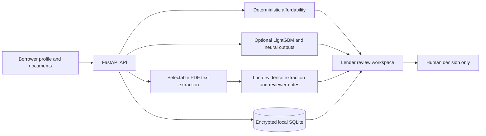

# Rakshak Credit

## Problem statement

People with irregular, gig, or small-business income may have limited conventional credit history, while lenders need a clearer view of cash flow and supporting evidence. Rakshak Credit is a prototype for organizing that information; it does not make lending decisions.

## Users & context

- **Borrowers:** salaried workers, gig workers, small-business owners, people starting a business, or people with no current occupation. They enter profile and monthly cash-flow details and provide PAN/identity, bank statement/account history, and ITR before requesting an estimate.
- **Lenders:** review the submitted information, documents, deterministic affordability calculations, experimental model outputs, and Luna's evidence-grounded notes. A human remains responsible for any real decision.
- **Context:** local MVP demonstration using synthetic training data and fictional sample documents. There is no live bank or Account Aggregator connection.

## Solution overview

The borrower workspace collects profile, income, expenses, existing debt, and three required documents: PAN/identity, bank statement/account history, and ITR. The backend encrypts saved application data and files in local SQLite. For a requested estimate, it calculates an illustrative capacity range and may run configured model components. Readable text from selectable PDFs is extracted with common identifiers masked and sent to Luna for unverified evidence extraction. The lender workspace can inspect the original file, read extracted text, review analysis, and record human-review status.



## Setup & run

### Requirements

- Windows PowerShell (the scripts are also adaptable for macOS/Linux)
- Python 3.11+ and Node.js/npm
- A Luna API endpoint, model ID, and key for live Luna calls. Mocked/unit tests do not need provider credentials.
- Tesseract is optional; without it, image and scanned-PDF OCR reports `ocr_unavailable`.

### Install

From the repository root:

```powershell
py -m venv .venv
.\.venv\Scripts\python.exe -m pip install -r backend\requirements.txt
Copy-Item backend\.env.example backend\.env
cd frontend
npm ci
cd ..
```

Edit `backend/.env` locally. Set `LUNA_API_URL`, `LUNA_MODEL_NAME` to an ID enabled for your API account, and `LUNA_API_KEY`. Also set a Fernet `DOCUMENT_ENCRYPTION_KEY`, a random `AUTH_SECRET_KEY` of at least 32 characters, and demo borrower/lender passwords. Keep `.env` private and out of Git. The frontend does not contain provider credentials. In this MVP flow, Luna performs both evidence extraction and reviewer explanation; the legacy Gemma extraction response fields are retained for API compatibility, but no Gemma call is made.

Generate a document encryption key without printing it in the terminal, then replace the blank value in `backend/.env`:

```powershell
cd backend
$key = ..\.venv\Scripts\python.exe -c "from cryptography.fernet import Fernet; print(Fernet.generate_key().decode())"
(Get-Content .env) -replace '^DOCUMENT_ENCRYPTION_KEY=.*$', "DOCUMENT_ENCRYPTION_KEY=$key" | Set-Content .env
$key = $null
cd ..
```

Keep that key stable and backed up securely. Changing it makes already-saved encrypted data unreadable.

### Run

Use two terminals from the repository root:

```powershell
.\run_backend.bat
```

```powershell
.\run_frontend.bat
```

Open <http://127.0.0.1:5173>. API documentation is at <http://127.0.0.1:8000/docs>. Sign in with the local usernames configured in `backend/.env` (`borrower.demo` and `lender.demo` by default); set your own demo passwords there. For a production frontend served over HTTPS, configure secure cookies and deploy the backend behind TLS.

### Verify

```powershell
cd backend
..\.venv\Scripts\python.exe -m unittest discover -s tests -v
cd ..\frontend
npm run build
```

The tests use mocked Luna responses except for separately run, synthetic-only provider smoke tests. Do not place real documents or secrets in test fixtures.

## Models & data (sources, licenses)

- **LightGBM baseline:** 26 cash-flow features; its output includes an experimental Rakshak score and risk estimate. The model was trained on project-generated synthetic labels.
- **Deep tabular neural model:** 77 input features; an incomplete or unsourced feature vector is skipped rather than filled with invented borrower values.
- **Luna:** configured through `LUNA_API_URL`, `LUNA_MODEL_NAME`, and `LUNA_API_KEY`. It extracts observations from submitted form data and readable PDF text, then writes reviewer support. It cannot change backend calculations or scores, approve/reject, or verify a document. The current tested account model ID is `gpt-6-luna`; configure an ID actually available to your own account.
- **Gemma:** a client module exists, but the current unified MVP flow assigns its former evidence-extraction role to Luna. Gemma is not called by that flow.
- **Data:** `data/` contains reproducibly generated synthetic borrower, transaction, and feature data (see `data/src/generate_data.py`, `data/README.md`, and `data/data/DATA_DICTIONARY.json`). The target `synthetic_missed_payment` is generated by a toy formula, not observed repayment. No real borrower or bank data is included.
- **Licensing:** no repository-level license file or third-party training dataset license is present. Treat the project as unlicensed unless the maintainers add a license. Check each dependency and any provider model terms before redistribution or commercial use.

## Evaluation & guardrails (hallucination/bias mitigations)

The audited synthetic held-out test comparison reports LightGBM at threshold `0.20` with ROC-AUC `0.6411`, accuracy `0.4622`, and recall `0.8000`; the neural model at threshold `0.28` reports ROC-AUC `0.5904`, accuracy `0.7289`, and recall `0.0167` (1 of 60 positive cases). These are pipeline diagnostics, not estimates of real-world lending performance. The comparison is not feature-parity: the LightGBM model uses 26 features, while the neural benchmark constructs 77 features using a template for fields absent from the test data. See `backend/DEPLOYMENT.md` and `artifacts/model_comparison.json` for details. No model was retrained as part of the document-intake work.

Guardrails in the prototype include:

- Backend financial calculations remain deterministic and authoritative; experimental model outputs remain separate.
- Complete, source-backed feature contracts are required for model scoring. Missing values do not get silently invented.
- Luna output is schema-validated, source-provenance checked, prompt-injection screened, and marked unverified. Common PAN, account, IFSC, Aadhaar-length, and phone patterns are masked before extracted PDF text is sent to Luna. Redaction is not exhaustive.
- Original uploaded files are encrypted at rest. Files are not sent to Luna; bounded extracted text is sent only when an estimate is requested. Review the original because parsing may be incomplete or incorrect.
- Role-restricted APIs separate borrower access from lender review. Human review is required; no experimental score is loan approval.
- Explicit gender, caste, and religion inputs are absent from the current feature contracts. The neural contract includes city/state/city-tier fields, which may act as proxies. The fairness endpoint is an audit scaffold, not evidence that the model is fair.

Current verification: 87 backend unit/API tests passed, the frontend production build passed, and a real unified API smoke test using a fictional sample bank PDF returned successful document extraction and Luna evidence/reviewer calls. The synthetic-only model smoke result is not an evaluation on real borrowers.

## Known limitations & risks

- The current intake does not collect every feature required by the saved scoring models. A borrower-facing model score is therefore unavailable unless a complete source-backed feature payload is provided.
- The displayed borrowing-capacity range is illustrative, not an offer. It assumes demo terms (12 months, 18% annual rate, a 35% repayment share, and a ₹2,000 safety buffer).
- Only selectable PDF text is extracted. OCR is not configured for image files or scanned PDFs; those files are reported as unreadable.
- Text extraction can omit, misread, or reorder content. Identifier masking is pattern-based and can miss sensitive information. Luna observations are not identity, bank, or tax verification.
- The local demo lacks malware scanning, formal retention/deletion policy, production account management, audit controls, and production deployment hardening. Do not use it to process real borrower documents on a shared or network-exposed deployment.
- Saved model artifacts were serialized with a different scikit-learn version than the current runtime; runtime warnings indicate a reproducibility risk.

## Team

**Chinthapenta Srikar** — solo contributor.

**Team:** Black Clover.
