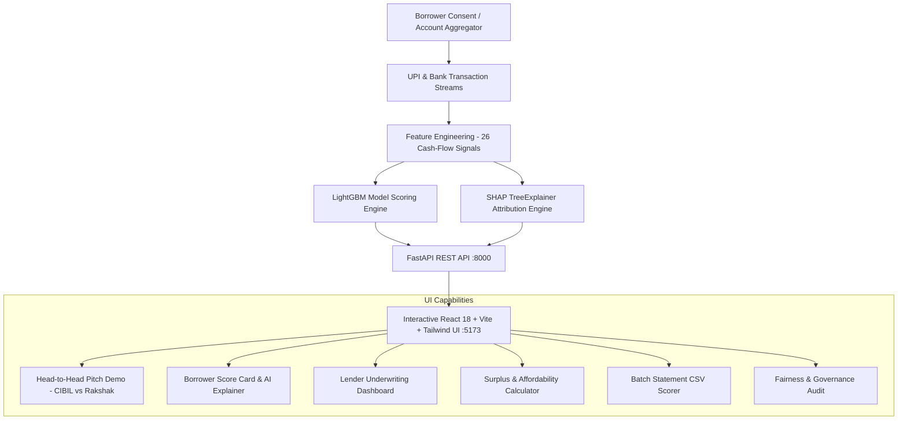

# Rakshak Credit — Cash-Flow Intelligence Engine

> *“Credit scores shouldn’t punish people for being new. We score how you earn, not what you owe.”*

A full-stack, AI-driven alternative credit scoring prototype for gig workers and small kirana shopkeepers who have no CIBIL track record, built from consented UPI and bank cash-flow data.

---

## 🎯 The Core Problem & Solution

- **The Problem:** Over 700 million credit-eligible Indians are "credit invisible" to traditional bureaus like CIBIL because they lack formal credit history. Lenders reject them or push them into 30%+ interest informal loans.
- **The Solution:** With consent via India's Account Aggregator (AA) framework, Rakshak analyzes transaction history to model income regularity, volatility, cash-flow coverage, and balance buffers. In seconds, it returns:
  1. A **Rakshak Credit Score** (300–900 scale)
  2. A **Safe Loan Limit** tailored to actual cash surplus
  3. **SHAP AI Explanations** detailing which financial habits helped or hurt
  4. **Actionable Improvement Coaching** to help borrowers boost their score

---

## 🏗️ System Architecture



---

## 🚀 Quick Start (Windows)

### Option 1: Convenience Scripts
```cmd
# Terminal 1: Start Backend (FastAPI on port 8000)
.\run_backend.bat

# Terminal 2: Start Frontend (Vite on port 5173)
.\run_frontend.bat
```

### Option 2: Manual Start

#### Backend
```powershell
.\.venv\Scripts\Activate.ps1
uvicorn backend.app.main:app --host 127.0.0.1 --port 8000 --reload
```
API Documentation & Swagger UI: **http://127.0.0.1:8000/docs**

#### Frontend
```powershell
cd frontend
npm run dev
```
Interactive Dashboard: **http://127.0.0.1:5173**

---

## 📊 Model Performance & Metrics

Trained on 1,500 synthetic borrower profiles across 26 engineered cash-flow features:

| Metric | Score | Note |
|---|---|---|
| **ROC-AUC** | **0.641** | Holdout test split evaluation |
| **Average Precision (PR-AUC)** | **0.385** | Test split benchmark |
| **Accuracy** | **73.8%** | At decision threshold |
| **Explainability** | **SHAP TreeExplainer** | Per-applicant Shapley attribution |
| **Top Predictive Drivers** | Monthly work costs, Income CV (volatility), Low balance days, Transaction regularity | Verified via global SHAP rankings |

---

## 🔌 API Endpoints

- `GET /api/v1/health` — API and model artifact status
- `GET /api/v1/applicants` — List seeded borrower profiles from synthetic dataset
- `GET /api/v1/applicants/{id}` — Individual applicant dossier
- `GET /api/v1/applicants/{id}/score` — Real-time scoring + SHAP explanations + coaching tips
- `GET /api/v1/demo/comparison` — Side-by-side CIBIL vs Rakshak pitch demo
- `POST /api/v1/eligibility/estimate` — Surplus and affordability arithmetic calculator
- `POST /api/v1/score` — Raw feature vector scoring
- `POST /api/v1/data/upload` — Batch statement CSV file upload
- `GET /api/v1/model/metrics` — Trained model evaluation metrics
- `GET /api/v1/model/feature-importance` — Global SHAP importance rankings
- `GET /api/v1/fairness/metrics` — Disparate impact and fairness audit scaffold

---

## ⚖️ Governance & Fairness Guardrails

1. **Excluded Protected Attributes:** Gender, caste, religion, and geographic region are strictly excluded from model feature inputs.
2. **Transparent Explainability:** Every decision provides plain-language reasons grounded in SHAP math.
3. **Data Provenance:** All training and demo records are synthetic; no personal identification or private banking records are stored.
